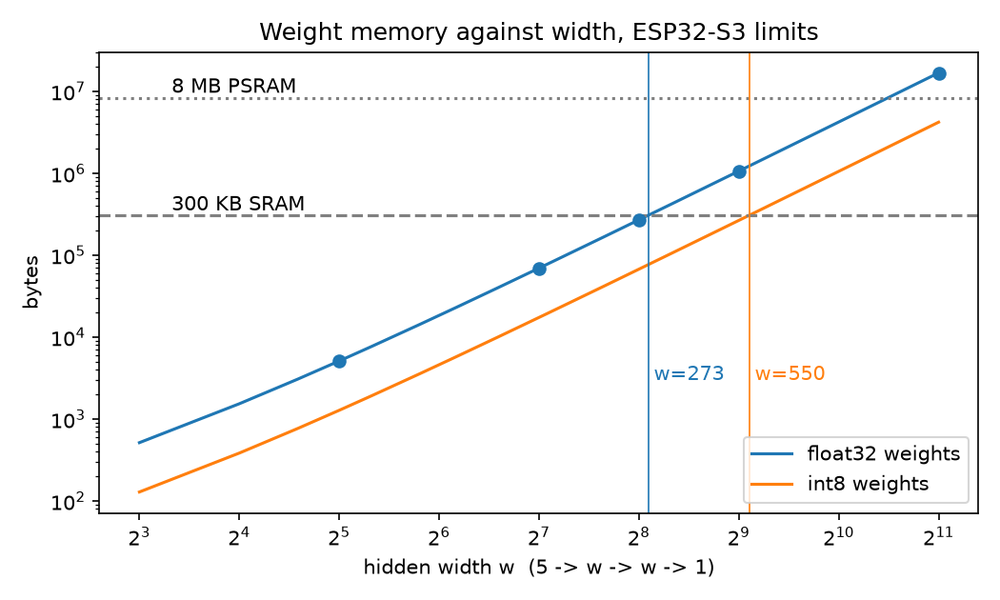

# Mission 4 Report: Would the Model Fit Inside the Doorbell?

Team 5 (Edgy) | Edge AI, Module 1 | Mission 4: memory, compute and the server-or-device decision

Target board: **ESP32-S3**, about 512 KB SRAM (about 300 KB free for our program), 8 MB PSRAM, 16 MB flash, two Xtensa LX7 cores at 240 MHz.

All tables are generated by `python mission4.py` into `docs/mission4_results.md`, using `app/stats.layer_table()`. That is the same function that serves `GET /model_info`, so the API and this report cannot disagree.

## 1. Summary

- Our model (5 → 32 → 32 → 1) needs **5,124 bytes of weights as float32** and **1,281 bytes as int8**. Its largest set of activations held at once is 64 values: 256 B as float32, 64 B as int8.
- Weights plus activations use about **1.75% of the 300 KB SRAM budget**, so it fits with room to spare, even without int8.
- For 5 → w → w → 1, the weights stop fitting in 300 KB at **w = 274 as float32** and **w = 551 as int8**. The last widths that fit are 273 and 550.
- One prediction should take about **10 to 50 µs** on the board. Calling our server took **41 to 880 ms** (median) in Mission 3, roughly 800 to 17,000 times longer.
- **Recommendation: run the model on the doorbell.** Optionally, report results to a server now and then.

## 2. How we count

For a layer `Linear(a, b)`:

| Quantity | Formula | Why |
|---|---|---|
| Parameters | a × b + b | a × b weights plus one bias per output |
| MACs per prediction | a × b | each output is a dot product of length a; adding the bias is not a multiply |
| Bytes | params × 4 (float32), params × 1 (int8) | 32-bit float against 8-bit integer |

ReLU has no parameters and only does comparisons, so it is not counted.

**What "300 KB" means.** We use 300 × 1024 = **307,200 bytes**, because SRAM sizes are specified in binary units. If the budget were 300,000 bytes, the boundary widths move slightly (section 5). Every other answer stays the same.

## 3. Our model

Hand calculation, done before running the script:

| Layer | in → out | Params | Bytes f32 | Bytes int8 | MACs |
|---|---|---|---|---|---|
| linear1 | 5 → 32 | 5·32 + 32 = 192 | 768 | 192 | 160 |
| linear2 | 32 → 32 | 32·32 + 32 = 1,056 | 4,224 | 1,056 | 1,024 |
| linear3 | 32 → 1 | 32·1 + 1 = 33 | 132 | 33 | 32 |
| **Total** | | **1,281** | **5,124** | **1,281** | **1,216** |

`GET /model_info` and `mission4.py` give exactly these numbers. `/health` reports `params: 1281`, which matches.

**Activation memory.** Layer *k* reads its input vector while it writes its output, so both must be in memory together. The peak is the largest in + out over all layers: 32 + 32 = **64 values**, which is 256 B as float32 or 64 B as int8. The input (5 values) and the output (1 value) are smaller. A layer-by-layer runtime can reuse two buffers, so the activations never need more than this.

**Total working set:** 5,124 + 256 = 5,380 B as float32, about 1.75% of 307,200 B. Quantising to int8 is not needed to fit. It would only cut memory and time further.

## 4. Scaling the width: 5 → w → w → 1

Closed forms, which the script checks against `layer_table`:

- params(w) = (5w + w) + (w² + w) + (w + 1) = **w² + 8w + 1**
- MACs(w) = 5w + w² + w = **w² + 6w**

| w | Params | float32 | int8 | 300 KB SRAM f32 | 300 KB SRAM int8 | 8 MB PSRAM f32 | 8 MB PSRAM int8 | MACs |
|---|---|---|---|---|---|---|---|---|
| 32 | 1,281 | 5,124 B (5.0 KiB) | 1,281 B | yes | yes | yes | yes | 1,216 |
| 128 | 17,409 | 69,636 B (68.0 KiB) | 17,409 B (17.0 KiB) | yes | yes | yes | yes | 17,152 |
| 256 | 67,585 | 270,340 B (264.0 KiB) | 67,585 B (66.0 KiB) | yes | yes | yes | yes | 67,072 |
| 512 | 266,241 | 1,064,964 B (1.02 MiB) | 266,241 B (260.0 KiB) | **no** | yes | yes | yes | 265,216 |
| 2048 | 4,210,689 | 16,842,756 B (16.06 MiB) | 4,210,689 B (4.02 MiB) | **no** | **no** | **no** | yes | 4,206,592 |

What the table shows:
- Memory and compute grow as **w²**, so doubling the width roughly quadruples both. The w² term (the 32 → 32 layer in our model) dominates as soon as w is more than a few tens.
- **int8 buys width, not just bytes.** Four times fewer bytes allows √4 = 2 times the width: 512 fits in SRAM only as int8.
- At w = 2048, float32 weights (16.06 MiB) are too big for the 8 MB PSRAM and even for the 16 MB flash. As int8 they would fit in PSRAM, but PSRAM is reached through a cache and is much slower than SRAM.

## 5. The exact width where the weights stop fitting

We need the largest w with bytes_per_param × (w² + 8w + 1) ≤ budget, which is a quadratic:

w² + 8w + (1 − budget / bytes_per_param) ≤ 0, so w ≤ (−8 + √(64 − 4(1 − budget / bytes_per_param))) / 2

**float32**, budget 307,200: w² + 8w + 1 ≤ 76,800, so w ≤ (−8 + √307,260) / 2 = (−8 + 554.31) / 2 = **273.16**.
- w = 273: 4 × 76,714 = 306,856 B, which fits.
- w = 274: 4 × 77,269 = 309,076 B, which does not.

**int8**, budget 307,200: w² + 8w + 1 ≤ 307,200, so w ≤ (−8 + √1,228,860) / 2 = (−8 + 1,108.54) / 2 = **550.27**.
- w = 550: 306,901 B, which fits.
- w = 551: 308,010 B, which does not.

`mission4.py` solves the same quadratic and then builds real networks at w and w + 1 to confirm. Results:

| Budget | Precision | Last width that fits | First width that does not |
|---|---|---|---|
| 307,200 B (used) | float32 | **273** | **274** |
| 307,200 B (used) | int8 | **550** | **551** |
| 300,000 B | float32 | 269 | 270 |
| 300,000 B | int8 | 543 | 544 |

These widths count weights only. A real program also needs the activations (2w values), the code and the runtime's buffers, so the practical limit is a little lower.

## 6. Estimated time for one prediction on the board

**Assumed speed and where it comes from.** Espressif publishes cycle counts for its ESP-DSP library. On the ESP32-S3, `dsps_dotprod_f32` with N = 256 takes **432 cycles** with the optimised assembly kernel and **1,311 cycles** with the plain-C version (ESP-DSP benchmarks, docs.espressif.com). A dot product of length 256 is 256 MACs, so that is **1.69 cycles per MAC** optimised and **5.12 cycles per MAC** in plain C. The clock is 240 MHz and we use one core.

time = MACs × cycles per MAC / 240,000,000

For our 1,216 MACs:
- optimised: 1,216 × 1.69 / 240 MHz = **8.5 µs**
- plain C: 1,216 × 5.12 / 240 MHz = **25.9 µs**
- plain C with a 2× margin for ReLU, loops and copying the inputs: **about 52 µs**

**We report about 10 to 50 µs.** This is an estimate from published benchmarks, not a measurement on our board. The ESP32-S3 also has 128-bit SIMD instructions for int8 and int16 multiply-accumulates, which Espressif's ESP-NN library uses. An int8 version would likely be faster still. We did not measure that.

For the larger widths: w = 256 needs about 0.5 to 2.9 ms, w = 512 about 2 to 11 ms, and w = 2048 about 30 to 180 ms (see `docs/mission4_results.md`).

## 7. Should the doorbell call our server or run the model itself?

**Recommendation: run it on the doorbell.** The model is 5 KB and takes microseconds. The only reason to use a server is to manage the model, not to compute it.

| Factor | Call our server | Run on the doorbell |
|---|---|---|
| **Latency** | Mission 3 median round trip of 41 to 87 ms with keep-alive and 883 ms without. The first request took 0.6 to 1.3 s. The model itself took about 0.2 ms of that. | About 10 to 50 µs, around 800 to 17,000 times faster, with no variation from the network. |
| **Privacy** | Every reading leaves the house: Wi-Fi strength, temperature, and how often the bell rings, which shows when people are home. | Nothing leaves the device unless we choose to send it. |
| **Cost** | A server must run around the clock and scale with every doorbell sold. Our Codespace was free only because it is a class project. | No extra cost per prediction. The chip is already in the product. |
| **Power** | Each prediction wakes the Wi-Fi radio, connects (Mission 3 measured about 150 ms of TCP + TLS set-up per new connection) and waits for the reply. Radio time dominates the battery cost. | About 2,000 to 6,000 CPU cycles. Negligible next to one radio wake-up. |
| **Wi-Fi down** | No prediction at all, so the "battery low" warning fails exactly when it may matter. Weak Wi-Fi is one of our model's own inputs, so poor coverage hurts twice. | Still works. The doorbell can warn locally (LED or chime) and sync later. |

**The server's real advantages:**
- The model can be updated without a firmware update.
- The company sees the whole fleet, for example which batteries fail early.
- Heavier models are possible.

None of these needs the server to compute each prediction. They can be met by running the model on the device and uploading a short summary now and then (for example, the predicted days left once a day, on a connection the doorbell is already making). New models can be shipped with normal over-the-air firmware updates. At 1.3 KB as int8, a model update is tiny.

## 8. Limits

- The board timings are estimates from Espressif's published dot-product benchmarks, not measured on hardware. They ignore cache misses, interrupts and the FreeRTOS scheduler.
- Memory counts cover the model only, not the code, the runtime or the Wi-Fi stack.
- The int8 sizes assume plain per-tensor int8 weights. Real quantisation also stores a scale and zero point per tensor, a few bytes per layer, and int8 accuracy was not measured.
- The Mission 3 latency numbers came from the earlier 8,8 model. Server inference was about 0.2 ms for both sizes, so the comparison holds.

## 9. Files

- `app/stats.py`: `layer_table()` and `peak_activation_values()`, the single source of truth for sizes
- `app/main.py`: `GET /model_info` returns `layer_table(net)`
- `mission4.py`: generates every table and the plot
- `docs/mission4_results.md`: the generated tables
- `results/mission4_widths.csv`: the width table as data
- `plots/mission4_memory.png`: weight memory against width, with the SRAM and PSRAM limits
