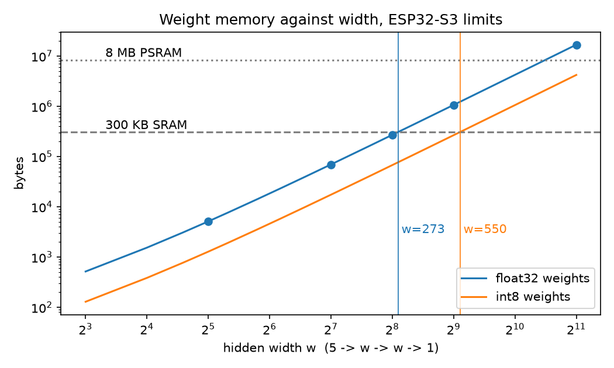

# Mission 4 results (generated by `mission4.py`, do not edit by hand)

SRAM budget: 300 KB read as 300 x 1024 = 307,200 bytes. PSRAM: 8 MB = 8,388,608 bytes.

## 1. Our model: 5 -> 32 -> 32 -> 1 (validation MAE 4.9 days)

| Layer | in | out | params | bytes f32 | bytes int8 | MACs |
|---|---|---|---|---|---|---|
| linear1 | 5 | 32 | 192 | 768 | 192 | 160 |
| linear2 | 32 | 32 | 1,056 | 4,224 | 1,056 | 1,024 |
| linear3 | 32 | 1 | 33 | 132 | 33 | 32 |
| **total** | | | **1,281** | **5,124** | **1,281** | **1,216** |

- Weights and biases: 5,124 B (5.0 KiB) as float32, 1,281 B (1.3 KiB) as int8.
- Largest activation memory at once: 64 values (one layer's input plus output) = 256 B as float32, 64 B as int8.
- Total working set (weights + peak activations), float32: 5,380 B (5.3 KiB) = 1.75% of the 300 KB budget.
- Fits in 300 KB SRAM: float32 yes, int8 yes.

## 2. 5 -> w -> w -> 1 at different widths

| w | params | float32 | int8 | 300 KB SRAM f32 | 300 KB SRAM int8 | 8 MB PSRAM f32 | 8 MB PSRAM int8 | MACs |
|---|---|---|---|---|---|---|---|---|
| 32 | 1,281 | 5,124 B (5.0 KiB) | 1,281 B (1.3 KiB) | yes | yes | yes | yes | 1,216 |
| 128 | 17,409 | 69,636 B (68.0 KiB) | 17,409 B (17.0 KiB) | yes | yes | yes | yes | 17,152 |
| 256 | 67,585 | 270,340 B (264.0 KiB) | 67,585 B (66.0 KiB) | yes | yes | yes | yes | 67,072 |
| 512 | 266,241 | 1,064,964 B (1.02 MiB) | 266,241 B (260.0 KiB) | NO | yes | yes | yes | 265,216 |
| 2048 | 4,210,689 | 16,842,756 B (16.06 MiB) | 4,210,689 B (4.02 MiB) | NO | NO | NO | yes | 4,206,592 |

Parameters grow as w^2 + 8w + 1 and MACs as w^2 + 6w: doubling the width roughly quadruples memory and compute.

## 3. The exact width where the weights stop fitting

Solve bytes_per_param x (w^2 + 8w + 1) <= budget with the quadratic formula, take the floor, then check w and w+1 on real networks with `layer_table`.

| Budget | Precision | Real root | Last width that fits | First width that does not |
|---|---|---|---|---|
| 300 x 1024 = 307,200 B (used) | float32 | 273.16 | 273 (306,856 B) | 274 (309,076 B) |
| 300 x 1024 = 307,200 B (used) | int8 | 550.27 | 550 (306,901 B) | 551 (308,010 B) |
| 300,000 B | float32 | 269.89 | 269 (298,056 B) | 270 (300,244 B) |
| 300,000 B | int8 | 543.74 | 543 (299,194 B) | 544 (300,289 B) |

int8 fits about twice the width of float32 (4x fewer bytes, and size grows as w^2, so width grows by sqrt(4) = 2).

## 4. Estimated time for one prediction on the ESP32-S3

Assumption: 240 MHz, one core. Cycles per float32 MAC from Espressif's ESP-DSP benchmarks (`dsps_dotprod_f32`, N = 256): 432 cycles optimised, 1311 cycles plain C on the ESP32-S3. Time = MACs x cycles per MAC / clock. ReLU and loop overhead are ignored, so we also show a 2x margin. This is an estimate, not a measurement.

| Model | MACs | optimised | plain C | plain C with margin |
|---|---|---|---|---|
| ours (5 -> 32 -> 32 -> 1) | 1,216 | 8.5 us | 25.9 us | 51.9 us |
| w = 32 | 1,216 | 8.5 us | 25.9 us | 51.9 us |
| w = 128 | 17,152 | 120.6 us | 366.0 us | 732.0 us |
| w = 256 | 67,072 | 471.6 us | 1,431.2 us | 2,862.3 us |
| w = 512 | 265,216 | 1,864.8 us | 5,659.1 us | 11,318.3 us |
| w = 2048 | 4,206,592 | 29,577.6 us | 89,759.8 us | 179,519.6 us |

## 5. On the board against calling our server (Mission 3 measurements)

| Benchmark file | round trip p50 | server_total p50 | inference p50 | round trip / on-board |
|---|---|---|---|---|
| bench_20261121_181159.csv | 1.6 ms | 0.208 ms | 0.118 ms | 31x |
| bench_20261121_232253.csv | 40.7 ms | 0.312 ms | 0.199 ms | 785x |
| bench_20261121_233137.csv | 622.6 ms | 0.355 ms | 0.222 ms | 11,998x |
| bench_20261121_234806.csv | 87.4 ms | 0.362 ms | 0.230 ms | 1,685x |
| bench_20261121_235107.csv | 883.5 ms | 0.351 ms | 0.219 ms | 17,026x |

On-board figure used: 51.9 us (plain C with margin). The benchmark files were measured on the 8,8 model; inference was a small part of server_total either way.

